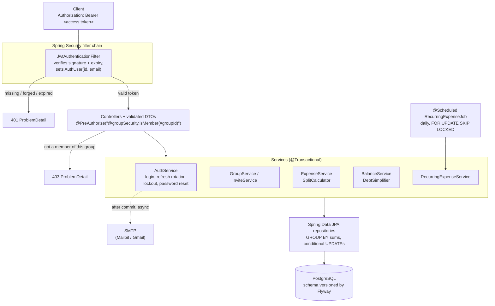

# ExSplit

[](https://github.com/tsetan13821/ExSplit/actions/workflows/ci.yml)

A Spring Boot REST backend for splitting shared expenses. Users sign up, create groups, invite friends with single-use links, record who paid for what, and get the **fewest payments needed to settle up**.

The focus is **Spring Security done properly** (stateless JWT access tokens, rotating refresh tokens with reuse detection, group-level authorization against IDOR) and a **debt-simplification algorithm** (greedy two-heap, at most n − 1 payments).

- **Live API:** _deploying to Render (link coming)_
- **Swagger UI:** `/swagger-ui.html` (locally: http://localhost:8080/swagger-ui.html)

---

## Contents

- [Tech stack](#tech-stack)
- [Architecture](#architecture)
- [Sessions vs JWT: why this design](#sessions-vs-jwt-why-this-design)
- [Design decisions](#design-decisions)
- [API](#api)
- [Running locally](#running-locally)
- [Testing](#testing)
- [Deployment](#deployment)
- [Project structure](#project-structure)

---

## Tech stack

| Layer | Choice |
|---|---|
| Language, framework | Java 21, Spring Boot 4, Maven |
| Web | Spring Web MVC, Bean Validation, RFC 9457 `ProblemDetail` errors |
| Security | Spring Security, JJWT (HS256), BCrypt, method security (`@PreAuthorize`) |
| Persistence | Spring Data JPA (Hibernate 7), PostgreSQL 16, Flyway migrations |
| Email | Spring Mail; Mailpit locally, Gmail SMTP in production |
| Testing | JUnit 5, MockMvc, spring-security-test, Testcontainers (real PostgreSQL) |
| API docs | springdoc-openapi (Swagger UI) |
| DevOps | Docker (multi-stage), Docker Compose, GitHub Actions, Render + Neon |

## Architecture

A single layered service. **The filter decides who you are; method security decides which groups you can touch; services own every business rule.**



A request is rejected at one of two points: the **filter** (401: no valid token) or **method security** (403: valid user, wrong group). Only then do services run, each inside a database transaction.

### Database

Ten tables, all created by Flyway (`src/main/resources/db/migration`). Money is always a `BIGINT` count of **paise**, never a float. Rules the schema enforces itself: unique lowercase emails, positive amounts, non-negative shares, `from_user <> to_user` on settlements, `day_of_month BETWEEN 1 AND 28`, composite primary keys on `group_members` and `expense_shares`.

Three rules the database cannot enforce, so the service layer does:

1. An expense's shares add up exactly to its amount.
2. The payer and every share holder are members of the expense's group.
3. A settlement's two users are both members of its group.

## Sessions vs JWT: why this design

| | Server sessions | Pure JWT | **This project** |
|---|---|---|---|
| Per-request cost | Session lookup | Signature check only | Signature check only |
| Horizontal scaling | Shared session store needed | Free | Free |
| Revocation / logout | Delete the session | Impossible until expiry | **Revoke the refresh token**; the 15-minute access token expires on its own |
| Stolen credential window | Until logout | Until expiry (often long) | 15 minutes for an access token; a replayed refresh token kills the whole session family |

**Authentication is stateless, revocation is stateful.** Every request carries a short-lived JWT (15 minutes, HS256, claims: `sub`, `email`, `iat`, `exp`, deliberately no roles or group ids, so nothing in the token can go stale). Long-lived refresh tokens (7 days) live in the database, which gives back the revocation that pure JWT lacks.

**Refresh token rotation with reuse detection.** Every `/auth/refresh` revokes the presented token and issues a new one in the same *family*. If an already-revoked token is ever presented again, someone copied it: the whole family is revoked and both the attacker and the victim must log in again.

**CSRF protection is off, on purpose.** Tokens travel in the `Authorization` header, never in cookies, so a malicious site cannot make a browser attach them.

## Design decisions

**Security**

- **SHA-256 for refresh/invite/reset tokens, BCrypt for passwords.** Tokens are 32 random bytes from `SecureRandom`: they cannot be brute-forced and must be looked up by hash, so a fast hash is right. Passwords are short and guessable, so they need a slow, salted hash. Only hashes are stored; the raw token is shown exactly once.
- **IDOR prevention.** Every group route checks membership against the database with `@PreAuthorize("@groupSecurity.isMember(#groupId)")`. Child resources are looked up by `(id, groupId)`, so `/groups/MINE/expenses/{someone else's id}` is a 404, not a delete. A group that doesn't exist answers 403 like someone else's group, so ids can't be probed.
- **The acting user always comes from the token**, never from the request body (e.g. a settlement's payer is the caller).
- **Account lockout.** 5 wrong passwords lock the account for 15 minutes. The lock is checked before the password, failures are counted with one atomic `UPDATE` (parallel guesses can't overwrite each other), and the response is the same `Invalid email or password` for unknown emails, wrong passwords and locked accounts, so attackers can't tell which emails exist. Unknown emails also run a dummy BCrypt check so timing doesn't leak either.
- **Password reset never reveals whether an email is registered:** always `202`, and the email is sent asynchronously after the transaction commits, so response time is the same too. A successful reset revokes every refresh token, invalidates other outstanding reset links, and clears any lockout.

**Concurrency: one conditional statement instead of read-then-write**

- **Invites** are claimed with `UPDATE ... SET used_at = now WHERE id = ? AND used_at IS NULL AND expires_at > now`. When two people accept the same link at once, Postgres row-locks the invite; the second update re-checks `used_at IS NULL` after the first commits and matches nothing. A test races 8 threads: exactly one joins.
- **Refresh tokens and reset tokens** use the same pattern, so a token can't be used twice by concurrent requests.
- **Recurring expenses** are posted by a daily job that locks each due row with `SELECT ... FOR UPDATE SKIP LOCKED`, so multiple app instances can never post the same one twice. Posting and moving `next_run_date` happen in one transaction per row; missed months are each posted with their own date.

**Money and algorithms**

- **Paise, not doubles.** `0.1` has no exact binary representation, so float sums drift. Integers are exact.
- **Equal splits hand out the remainder deterministically:** ₹100 three ways is 3334 + 3333 + 3333 paise, the extra paisa going to the lowest user ids. Shares always sum exactly to the amount.
- **Balances are computed in SQL** with four `GROUP BY user` queries (paid, owed, settlements sent, settlements received) rather than loading every expense into memory. Nets must sum to zero; the service fails loudly if they don't.
- **Debt simplification** (`DebtSimplifier`): put creditors and debtors in two max-heaps, repeatedly have the largest debtor pay the largest creditor the smaller of the two amounts. Each step settles at least one person fully, so there are **at most n − 1 payments in O(n log n)**. The true minimum is NP-hard (it contains subset-sum), so greedy is a deliberate trade-off. Ties break by user id so suggestions are stable.

**Engineering**

- **Feature packages, not layer packages:** `auth/`, `group/`, `expense/`, `settlement/`, `recurring/` each hold their own controller, service, entities and repositories.
- **An injected `java.time.Clock`** is used for every expiry check (tokens, lockout, invites, recurring jobs). Tests jump time forward instead of sleeping.
- **`SplitCalculator` and `DebtSimplifier` are plain Java** with no Spring dependencies, so they're unit-tested directly.
- **Errors are RFC 9457 `ProblemDetail`** everywhere, including 401/403 from the security layer, with per-field messages for validation failures.

## API

All endpoints are under `/api`. Amounts are in paise. "Member" means a valid access token **and** membership of that group; anything else gets 403.

| Method | Path | Access | Purpose |
|---|---|---|---|
| POST | `/auth/register` | Public | Create an account (409 if the email exists) |
| POST | `/auth/login` | Public | Returns `accessToken`, `refreshToken`, `expiresIn` |
| POST | `/auth/refresh` | Refresh token | Rotate: new pair, old token revoked |
| POST | `/auth/logout` | Refresh token | Revoke the token's family |
| POST | `/auth/password-reset/request` | Public | Emails a reset token; always 202 |
| POST | `/auth/password-reset/confirm` | Reset token | Set new password, revoke all refresh tokens |
| GET | `/users/me` | JWT | Current user |
| POST | `/groups` | JWT | Create a group; creator becomes OWNER |
| GET | `/groups` | JWT | Only the groups you belong to |
| GET | `/groups/{groupId}` | Member | Group details and members |
| POST | `/groups/{groupId}/invites` | Owner | 48-hour, single-use invite link |
| POST | `/invites/{token}/accept` | JWT | Join the group |
| POST | `/groups/{groupId}/expenses` | Member | Add an expense (`EQUAL` or `EXACT` split) |
| GET | `/groups/{groupId}/expenses?page=&size=` | Member | Paginated, newest first |
| DELETE | `/groups/{groupId}/expenses/{expenseId}` | Creator or owner | Remove an expense |
| GET | `/groups/{groupId}/balances` | Member | Net balance per member |
| GET | `/groups/{groupId}/settlements/suggested` | Member | Simplified "who pays whom" |
| POST | `/groups/{groupId}/settlements` | Member | Record a payment you made |
| POST | `/groups/{groupId}/recurring-expenses` | Member | Monthly expense, split equally among members |
| GET | `/groups/{groupId}/recurring-expenses` | Member | Active recurring expenses |
| DELETE | `/groups/{groupId}/recurring-expenses/{id}` | Owner | Stop a recurring expense |

Example, an exact split:

```http
POST /api/groups/7/expenses
Authorization: Bearer eyJhbGciOi...
Content-Type: application/json

{
  "description": "Dinner at Goa",
  "amountPaise": 90000,
  "paidBy": 42,
  "splitType": "EXACT",
  "shares": [
    { "userId": 42, "sharePaise": 30000 },
    { "userId": 43, "sharePaise": 40000 },
    { "userId": 44, "sharePaise": 20000 }
  ]
}
```

For `EQUAL`, send `participantIds` instead of `shares` and the server computes each share.

Errors look like this:

```json
{ "title": "Bad Request", "status": 400,
  "detail": "Shares add up to 70000 paise but the expense is 90000 paise" }
```

## Running locally

Requirements: JDK 21+, Docker.

```bash
cp .env.example .env          # then set JWT_SECRET: openssl rand -base64 32
./mvnw spring-boot:run        # starts Postgres + Mailpit via compose.yaml, then the app
```

| What | Where |
|---|---|
| API | http://localhost:8080/api |
| Swagger UI | http://localhost:8080/swagger-ui.html |
| Mailpit inbox (reset emails) | http://localhost:8025 |
| Health | http://localhost:8080/actuator/health |
| PostgreSQL | `localhost:5433` (not 5432, to avoid clashing with a local install) |

Configuration is read from environment variables (or `.env` locally); see [`.env.example`](.env.example). Secrets are never committed.

Or run the production image:

```bash
docker build -t exsplit .
docker run -p 8080:8080 -e DB_URL=... -e DB_USER=... -e DB_PASSWORD=... -e JWT_SECRET=... exsplit
```

## Testing

```bash
./mvnw verify                 # needs Docker running (Testcontainers)
```

**684 tests**, all green in CI on every push and pull request:

| Level | Tools | What is covered |
|---|---|---|
| Unit | JUnit 5 | `SplitCalculator` (remainders, bad exact splits, 1,000 random splits), `DebtSimplifier` (Goa trip, all-zero, one debtor/many creditors, **500 randomized groups** that must clear in ≤ n − 1 payments), `JwtService` (expired, forged, wrong key), `TokenGenerator` |
| Web and security | MockMvc, spring-security-test | **55 parameterized authorization checks across every group endpoint**: 401 without a token, 403 for non-members, for missing groups, and for members on owner-only routes; validation errors as `ProblemDetail` |
| Integration | `@SpringBootTest`, Testcontainers PostgreSQL 16 | Full flow from sign-up to settled up; refresh rotation and reuse detection; lockout after 5 failures; password reset; recurring job |
| Concurrency | `ExecutorService` + `CountDownLatch` | 8 threads accept one invite: exactly one joins. 20 parallel wrong passwords still lock the account |
| Time | Controllable `Clock` | Token expiry, lockout end, invite expiry, reset-link expiry, recurring job posts exactly once |

`JavaMailSender` is replaced by a capturing fake in tests, so no test depends on an SMTP server.

## Deployment

Render (web service from the `Dockerfile`) + Neon (serverless PostgreSQL). Flyway migrates the schema on startup.

1. **Neon:** create a project and copy the connection details. Use `jdbc:postgresql://<host>/<database>?sslmode=require` as `DB_URL`, plus `DB_USER` and `DB_PASSWORD`.
2. **Render:** *New → Blueprint*, pick this repository. [`render.yaml`](render.yaml) defines the service and health check (`/actuator/health`).
3. Fill in the secrets Render asks for: `DB_URL`, `DB_USER`, `DB_PASSWORD`, `JWT_SECRET` (`openssl rand -base64 32`), `APP_BASE_URL` (the service URL), and for reset emails `MAIL_USERNAME` / `MAIL_PASSWORD` / `MAIL_FROM` (a Gmail address with an [app password](https://support.google.com/accounts/answer/185833)).
4. Every push to `main` redeploys automatically.

The image is a multi-stage build: Maven on a JDK 21 image, then only the jar on `eclipse-temurin:21-jre`, running as a non-root user with the heap sized from the container's memory limit.

## Project structure

```
src/main/java/com/tenzin/splitter/
├── security/     SecurityConfig, JwtAuthenticationFilter, JwtService, GroupSecurity,
│                 401/403 handlers, AuthUser
├── auth/         register, login, refresh rotation, logout, lockout, password reset
├── user/         User entity, GET /users/me
├── group/        groups, members, invites
├── expense/      expenses, SplitCalculator
├── settlement/   balances, DebtSimplifier, settlements
├── recurring/    recurring expenses and the daily job
└── common/       GlobalExceptionHandler, TokenGenerator, Clock, OpenAPI, paging
src/main/resources/db/migration/   V1__users.sql ... V5__password_reset_and_recurring.sql
```
